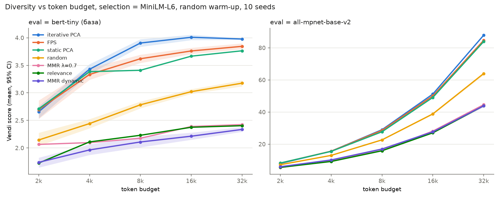
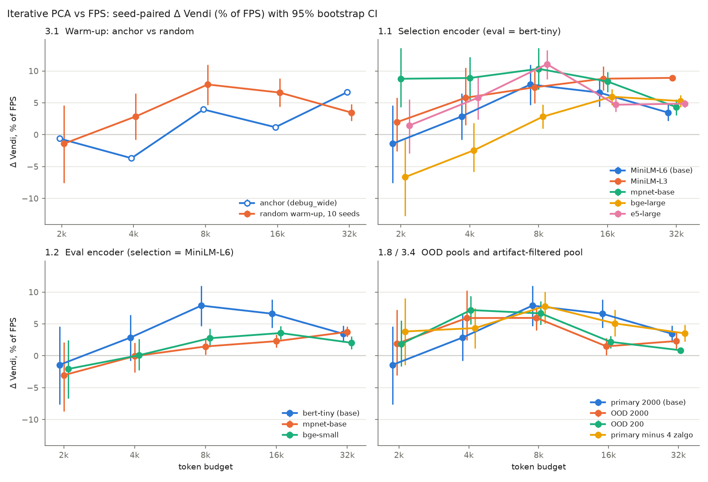

# Essential-эксперименты: результаты

Дополнение к документу Findings (04). Формат тот же: каждый пункт помечен
**FACT** (измерено), **HYPOTHESIS** (механизм не доказан) или **LIMITATION**
(известная слабость) и ссылается на артефакт. Пути к `data/` и `results/`
даны относительно корня репозитория; эти каталоги в gitignore, поэтому
небольшие сводные файлы скопированы в `docs/05_essential/`.

Закрытые эксперименты из документа 3: **3.1** (randomized warm-up),
**1.1** (selection-энкодеры), **1.2** (eval-энкодеры), **1.8** (OOD),
**3.4** (qualitative check), **3.3** (downstream с LLM, в формате пилота —
см. раздел 7).





---

## 0. Сводка в один абзац

Главный результат Findings — iterative PCA (ipa) обгоняет FPS по Vendi на
бюджетах от 8192 — **подтверждается и становится статистически значимым**.
При случайном warm-up и 10 сидах парная Δ(ipa − FPS) положительна, а 95% CI
не пересекает 0 на 8192, 16384 и 32768. Эффект держится на всех 5
selection-энкодерах, на всех 3 eval-энкодерах (полная матрица 5 × 3 — 15
комбинаций: значимо на 16k/32k во всех 15, на 8k в 12 из 15), на отложенных
(OOD) историях и на пуле без мусорных пассажей. Величина эффекта скромная:
в значимых ячейках +1…+11% Vendi относительно FPS, типично +2…+5% на 32k. **Coverage radius
не воспроизводится**: выигрыш ipa по радиусу (+0.11 в Findings) появляется
только в пространстве bert-tiny и пропадает, если убрать из пула 4
zalgo-пассажа; в пространстве mpnet Δ радиуса слегка отрицательная.
Qualitative check: подавляющее большинство пассажей ipa — нормальная
художественная проза, но ipa охотнее всех берёт «мусор» (zalgo-текст,
мета-посты Reddit): 11% в слепой выборке против 6% у FPS. Downstream-пилот
(6 задач, судья — независимая LLM) связи «больше Vendi контекста → лучше
ответ» не показал.

---

## 1. Окружение и воспроизведение (FACT)

Окружение совпадает с Findings §1: Windows, только CPU, torch 2.15.0+cpu,
transformers 5.22.1. Python 3.12 (у авторов был 3.13 — на результат не
влияет, см. ниже).

Данные пересобраны с параметрами из Findings §1: 5000 историй, токенизатор
Llama-3, 256 токенов на пассаж, 13 402 пассажа; split 3967 train / 1003 OOD
историй; primary — 2000 пассажей, OOD — 200. Дополнительно собран OOD-пул на
2000 пассажей (918 историй; с primary не пересекается ни по одной истории;
пул OOD-200 — его подмножество).

**Воспроизведение точное.** Спектр: 116 сигнальных направлений из 384,
PR = 80.88, top-1 = 5.36%. `debug_wide` (повторён как `debug_wide_repro`):
таблицы Vendi и coverage radius совпадают с Findings §3.1 до третьего знака.
Значит, пересобранные данные идентичны авторским и все новые прогоны
сравнимы со старыми.

Команды — `scripts/run_essential.sh` (полный список прогонов); подготовка
данных описана в шапке скрипта.

---

## 2. Эксперимент 3.1: randomized warm-up (FACT)

**Что сделано.** В `run_sweep` добавлен флаг `pass_anchor` для каждого
селектора. Документы утверждали, что он уже реализован, но в коде его не
было: anchor передавался всем селекторам всегда, и `warmup: norm` у
iterative_pca тоже игнорировался. Конфиг `configs/experiments/randomized.yaml`:
для fps, iterative_pca, static_pca и mmr_dynamic стоит `pass_anchor: false`,
warm-up случайный, 10 сидов, reference = fps. При одном и том же сиде fps,
ipa и mmr_dynamic стартуют с **одной и той же** случайной точки, так что Δ —
честно парное сравнение. relevance и mmr по контракту требуют anchor;
static_pca не имеет warm-up — эти три метода остаются детерминированными.

**Результат** (`results/metrics/randomized*.parquet`):

| бюджет | Vendi ipa | Vendi FPS | Δ | 95% CI | значимо |
|---:|---:|---:|---:|---|:---:|
| 2048 | 2.657 | 2.695 | −0.038 | [−0.205, +0.124] | нет |
| 4096 | 3.429 | 3.334 | +0.095 | [−0.027, +0.215] | нет |
| 8192 | 3.905 | 3.619 | **+0.285** | [+0.169, +0.397] | да |
| 16384 | 4.009 | 3.761 | **+0.248** | [+0.165, +0.332] | да |
| 32768 | 3.977 | 3.844 | **+0.133** | [+0.082, +0.183] | да |

* CI узкие, как и ожидалось в документе 3: std Vendi у ipa по сидам — от
  0.18 (2k) до 0.026 (32k). ipa стабильнее FPS (0.29 → 0.088): при большом
  |S| выбор ipa почти не зависит от стартовой точки.
* По сравнению с anchor-версией картина по бюджетам сдвинулась: Δ на 8k
  стала больше (+0.285 против +0.153), на 32k меньше (+0.133 против +0.251).
  Точные дельты из Findings §3.1 — один частный случай (старт из самого
  центрального пассажа); корректно цитировать именно CI из таблицы выше.
* Фразы «FPS падает на 32768, а ipa растёт» (Findings §3.2, §6.1) при
  случайном старте больше нет: FPS монотонно растёт (3.62 → 3.76 → 3.84).
  Падение FPS на 32k было свойством конкретного старта.
* Coverage radius: Δ = +0.047…+0.065, значимо на 8k+, но см. §5 — этот
  результат не устойчив.

---

## 3. Эксперимент 1.1: другие selection-энкодеры (FACT)

Eval-энкодер везде прежний — bert-tiny. Энкодеры:

* paraphrase-MiniLM-L3-v2 — 384-d, mean pooling;
* all-mpnet-base-v2 — 768-d, mean pooling;
* bge-large-en-v1.5 — 1024-d, **CLS pooling** (`hf_cls`: так bge обучен);
* e5-large-v2 — 1024-d, mean pooling.

Конфиги — `configs/embed/alt/`.

Δ Vendi (ipa − FPS) в % от FPS; «+» / «−» — CI выше / ниже 0, «0» — CI
пересекает 0:

| selection-энкодер | 2048 | 4096 | 8192 | 16384 | 32768 |
|---|---|---|---|---|---|
| MiniLM-L6 (база) | −1.4% 0 | +2.9% 0 | +7.9% + | +6.6% + | +3.5% + |
| MiniLM-L3 | +2.0% 0 | +5.8% + | +7.4% + | +8.8% + | +8.9% + |
| mpnet-base | +8.8% + | +8.9% + | +10.3% + | +8.3% + | +4.3% + |
| bge-large | −6.7% − | −2.4% 0 | +2.8% + | +6.0% + | +5.3% + |
| e5-large | +1.4% 0 | +5.8% + | +11.1% + | +4.7% + | +4.9% + |

* **На всех 5 энкодерах ipa > FPS значимо на 8k, 16k и 32k.** Это свойство
  задачи и данных, а не артефакт MiniLM — основной результат укрепляется.
* **Порог перехода зависит от энкодера.** У mpnet эффект есть уже с 2k, у
  MiniLM-L3 и e5 — с 4k, у bge-large переход позже, а на 2k ipa значимо
  хуже. Формулировку «фазовый переход между 4096 и 8192» стоит
  смягчить до «при |S| ≳ 20–35 пассажей; точный порог зависит от
  энкодера».

**Спектры** selection-пространств (primary pool, `docs/05_essential/spectral_*.json`):

| энкодер | d | сигнальных (выше MP) | PR | top-10 | top-50 |
|---|---:|---:|---:|---:|---:|
| MiniLM-L6 | 384 | 116 (30%) | 80.9 | 27.2% | 58.0% |
| MiniLM-L3 | 384 | 156 (41%) | 66.2 | 30.1% | 66.1% |
| mpnet-base | 768 | 291 (38%) | 83.3 | 27.1% | 58.7% |
| bge-large | 1024 | 374 (37%) | 104.0 | 23.7% | 52.2% |
| e5-large | 1024 | 310 (30%) | 128.0 | 19.7% | 42.0% |

HYPOTHESIS: все пять пространств находятся в одном режиме — структура
распределена по десяткам и сотням направлений, а не по 3–5. Поэтому эффект
есть везде, и сопоставить «спектр, где эффекта нет» со «спектром, где он
есть» пока не на чем. Явной связи PR с порогом перехода не видно: у
bge-large переход самый поздний при PR = 104, у e5 ранний при PR = 128.

---

## 4. Эксперимент 1.2: другие eval-энкодеры (FACT)

Eval-энкодеры: bert-tiny (текущий; это не sentence-энкодер, а крошечный
необученный под эмбеддинги BERT), all-mpnet-base-v2 и bge-small-en-v1.5
(CLS). Сначала при selection = MiniLM-L6, затем полная матрица
selection × eval (кроме пары mpnet/mpnet, которую запрещает правило двух
энкодеров).

| selection → eval | 2048 | 4096 | 8192 | 16384 | 32768 |
|---|---|---|---|---|---|
| MiniLM-L6 → bert-tiny | −1.4% 0 | +2.9% 0 | +7.9% + | +6.6% + | +3.5% + |
| MiniLM-L6 → mpnet | −3.0% 0 | −0.1% 0 | +1.5% + | +2.3% + | +3.8% + |
| MiniLM-L6 → bge-small | −2.1% 0 | +0.1% 0 | +2.8% + | +3.6% + | +2.0% + |
| MiniLM-L3 → mpnet | −3.1% 0 | −0.5% 0 | −0.5% 0 | +1.5% + | +1.2% + |
| MiniLM-L3 → bge-small | −2.6% 0 | +1.4% 0 | +2.1% + | +1.9% + | +2.7% + |
| mpnet → bge-small | +2.3% 0 | +4.0% + | +2.8% + | +2.8% + | +1.9% + |
| bge-large → mpnet | +0.1% 0 | −0.2% 0 | −1.2% 0 | +3.6% + | +3.4% + |
| bge-large → bge-small | +0.9% 0 | +1.4% 0 | +0.8% 0 | +2.9% + | +1.9% + |
| e5-large → mpnet | −5.3% − | +1.7% 0 | +3.4% + | +3.3% + | +3.7% + |
| e5-large → bge-small | −4.4% − | +2.5% 0 | +4.5% + | +2.2% + | +3.3% + |

Вместе с пятью строками из §3 это 15 комбинаций:

* **16384 и 32768: ipa > FPS значимо в 15 из 15.**
* **8192: значимо в 12 из 15**; в трёх CI пересекает 0 (MiniLM-L3 → mpnet,
  bge-large → mpnet, bge-large → bge-small).
* **2048–4096: эффекта нет или он неустойчив;** в двух комбинациях с e5 на
  2048 ipa значимо хуже.
* В сильных eval-пространствах относительный эффект меньше, чем под
  bert-tiny: +2…+4% на 32k против +3.5…+9%. Абсолютная Vendi под mpnet
  на порядок больше (≈85–88 при 146 пассажах), поэтому сравнивать по шкале
  можно только относительные Δ.

Вывод по критериям документа 3: «все три eval показывают Δ > 0 → результат
устойчив к выбору eval-метрики. Сильное подтверждение». Это выполнено для
бюджетов ≥ 16k и почти полностью для 8k.

---

## 5. Coverage radius не устойчив (FACT)

Δ coverage radius (ipa − FPS):

| прогон | 8192 | 16384 | 32768 |
|---|---|---|---|
| anchor (debug_wide) | +0.103 + | +0.115 + | +0.109 + |
| randomized (bert-tiny) | +0.047 + | +0.065 + | +0.065 + |
| eval = mpnet | −0.007 − | −0.010 − | −0.009 − |
| eval = bge-small | −0.003 0 | +0.024 0 | +0.009 + |
| пул без 4 zalgo (bert-tiny) | +0.040 + | −0.014 0 | −0.018 0 |
| пул без 4 zalgo, eval = mpnet | −0.003 0 | −0.009 − | −0.010 − |
| OOD-2000, eval = mpnet | −0.010 − | −0.007 − | −0.007 − |

Радиус — это максимум расстояния до центроида, то есть его задаёт один
самый далёкий пассаж. В пространстве bert-tiny таким пассажем оказывается
zalgo-текст (§6), а ipa берёт такие пассажи чаще FPS. Стоит убрать их из
пула или сменить eval-энкодер — выигрыш исчезает. **Coverage radius из
Findings §3.1 не стоит приводить как второе независимое подтверждение.**
Vendi, наоборот, устойчив ко всем этим проверкам.

---

## 6. Эксперимент 3.4: qualitative coherence check (FACT + LIMITATION)

**Что сделано** (`experiments/run_qualitative.py`). Бюджет 32768,
primary pool, настройки как в `randomized.yaml`, сид 0: random — 136
пассажей, relevance — 129, FPS — 145, ipa — 146.

1. **Автоматические признаки мусора** по всем 10 сидам
   (`docs/05_essential/artifact_stats.csv`). По длине, доле букв, верхнему
   регистру, type-token ratio и цифрам ipa и FPS почти не отличаются от
   пула. Отличается один признак — **доля не-ASCII символов**: пул 0.003,
   random 0.004, FPS 0.009, ipa **0.015**. Среди пассажей, которые на сиде 0
   выбрала только ipa, — 0.020; среди выбранных только FPS — 0.002.
2. **Причина — zalgo-текст.** В пуле 4 пассажа с долей не-ASCII > 10%
   (0.2% пула): два почти целиком из «глитчевых» комбинирующих диакритик,
   один написан small-caps-юникодом, один — смесь. Сколько их выбирает
   метод в среднем по 10 сидам:

   | метод | 8192 | 32768 | медианный шаг первого выбора |
   |---|---:|---:|---:|
   | static_pca | 2.0 | 3.0 | 4 |
   | **iterative_pca** | 1.9 | **3.9 из 4** | 8.5 |
   | FPS | 1.5 | 2.2 | 10 |
   | random | 0.2 | 0.4 | — |
   | mmr_dynamic | 0.0 | 0.0 | — |

   Diversity-методы выбирают такие выбросы рано — это ровно риск из
   proposal §7.1. В embedding-пространстве они действительно «далеко» от
   всего остального.
3. **Слепое чтение.** Сделана слепая выборка: по 30 пассажей от каждого
   метода, перемешанные, без указания метода — всего 113 уникальных
   пассажей (`docs/05_essential/blind_key.csv`). Пассаж, выбранный
   несколькими методами, засчитывается каждому из них. Читал и размечал
   LLM-читатель, не человек (см. LIMITATION ниже), по шкале из документа 3:
   * **ok** — осмысленная художественная проза;
   * **style** — читаемый текст, в котором заметную часть занимает
     нетипичная форма: заметки автора, ссылки, статистика карт;
   * **garbage** — художественного содержания нет: zalgo, мета-посты
     сабреддита.

   | метод | прочитано | ok | style | garbage |
   |---|---:|---:|---:|---:|
   | relevance | 31 | 93.5% | 6.5% | 0% |
   | random | 33 | 87.9% | 9.1% | 3.0% (1) |
   | FPS | 47 | 87.2% | 6.4% | 6.4% (3) |
   | iterative_pca | 45 | 80.0% | 8.9% | **11.1% (5)** |

   Garbage у ipa — это 2 zalgo, AMA-список вопросов модераторам, промо
   флейров сабреддита и советы автора о планировании текста; три из пяти
   совпадают с FPS. Остальные пассажи ipa — обычные истории из самых
   разных жанров: фэнтези, sci-fi, хоррор, сатира, драма, фанфики.
   Тематическое разнообразие внутри каждой выборки высокое у всех методов:
   у каждого прочитанного пассажа своя тема. Глазами отличить методы по
   «разнообразию тем» при n ≈ 30 нельзя; различаются они только долей
   мусора.
4. **Контроль: пул без zalgo** (`experiments/make_clean_pool.py`, прогоны
   `clean` и `clean__eval_mpnet`). Механическое правило «доля не-ASCII
   ≤ 0.1» убирает ровно 4 пассажа. Абсолютная Vendi падает у обоих методов
   (на 32k: FPS 3.84 → 3.67, ipa 3.98 → 3.80), то есть выбросы раздували
   Vendi всем. Но **Δ(ipa − FPS) сохраняется**: +7.8% / +5.1% / +3.5% на
   8k / 16k / 32k под bert-tiny и +3.0% / +2.1% / +4.0% под mpnet, всё
   значимо. Выигрыш ipa по Vendi держится не на zalgo.

**Интерпретация.** Гипотеза A из Findings §6.2 («ipa находит новые
направления») в основном подтверждается: большинство выбранного —
нормальные и разные тексты, а выигрыш по Vendi переживает удаление
выбросов. Но у ipa есть и измеримый крен в сторону B: она собирает
семантические выбросы (не-художественные мета-тексты Reddit и
юникод-мусор) заметно охотнее FPS и random. Практический вывод для
применения метода: нужен предфильтр (доля не-ASCII, детектор мета-постов
вида «Edit:», «/r/», ссылки) — это дёшево и не мешает эффекту.

**LIMITATION.**
* Размечал один читатель, и это LLM, хотя и вслепую.
* n ≈ 30–47 на метод: разница 11% против 6% — это 5 против 3 пассажей,
  отдельно статистически она не значима; значима только автоматическая
  метрика zalgo по 10 сидам.
* Для независимой проверки человеком используйте
  `results/qualitative/blind_sample.md` + `blind_key.csv` и шаблон
  `blind_annotations.csv` (колонки `id,label,theme`).

---

## 7. Эксперимент 3.3: downstream с LLM — пилот (FACT + LIMITATION)

**Дизайн** (`experiments/run_downstream.py`):

* 6 GM-задач: подземелье, город, злодей, таверна, путешествие, твист.
* Контексты random / relevance / FPS / ipa на бюджете 8192 (32–36
  пассажей), сид 0, плюс контроль без контекста.
* **Генератор:** claude-opus-5-5 (OpenAI-совместимый прокси ai-funpay),
  temperature 0.7, около 400 слов.
* **Судья — другая модель:** `shupp` на прокси api.shupp.ru; сама модель
  называет себя «GPT Luna 6»; запросы без temperature, потому что прокси
  её не принимает. Судья не видит метод и оценивает:
  * (A) парные сравнения всех 6 пар методов в обоих порядках показа — 72
    суждения;
  * (B) абсолютные оценки 1–10 по четырём критериям;
  * (C) какие пассажи контекста отражены в ответе.
* Все вызовы кэшируются: `results/downstream/cache/`.

Почему судья другой: на первом прокси кончилась квота (429 после 30
генераций и 19 оценок), а второй не отдаёт claude-opus-5-5. Чтобы все
оценки шли от одного судьи, 19 оценок от Opus отложены в
`results/downstream/archive_opus_judge_partial/` и в анализе не
участвуют. Плюс такой схемы: у судьи нет self-preference к ответам
генератора.

**Парные сравнения** (`docs/05_essential/pairwise_by_task.csv`). Единица
анализа — задача: оба порядка показа усредняются, затем знаковый тест по
6 задачам.

| пара | доля побед первого | задач: первый / второй / ничья | p (sign test) |
|---|---:|---|---:|
| random vs relevance | 0.958 | 6 / 0 / 0 | **0.031** |
| random vs FPS | 1.000 | 6 / 0 / 0 | **0.031** |
| random vs ipa | 0.583 | 3 / 2 / 1 | 1.00 |
| relevance vs FPS | 0.500 | 1 / 1 / 4 | 1.00 |
| ipa vs relevance | 0.833 | 5 / 1 / 0 | 0.22 |
| ipa vs FPS | 0.833 | 5 / 1 / 0 | 0.22 |

* Win rate по всем суждениям: random 0.85, ipa 0.69, relevance 0.24,
  FPS 0.22.
* Позиционного смещения у судьи нет: первый показанный ответ побеждает в
  48.6% случаев.

**Абсолютные оценки** (1–10, среднее по 6 задачам; `docs/05_essential/absolute.csv`):

| условие | idea_variety | originality | coherence | overall |
|---|---:|---:|---:|---:|
| без контекста | 7.83 | 7.67 | 9.00 | 8.67 |
| relevance | 8.00 | 8.00 | 8.33 | 8.33 |
| random | 7.83 | 8.17 | 8.83 | 8.67 |
| FPS | 7.33 | 7.50 | 8.50 | 7.83 |
| iterative_pca | 7.83 | 8.17 | 8.83 | 8.67 |

Оценки упираются в потолок (8–9) и почти не различают условия; контекст
не улучшает оценку относительно ответа без контекста.

**Использование контекста.** По мнению судьи, ответ отражает 0.5–2.3
пассажа из 32–36. Лексический прокси без LLM даёт то же самое: 0.3–1.8
пассажа (`experiments/analyze_downstream_offline.py`,
`docs/05_essential/offline_summary.csv`). Модель почти не заимствует
конкретику из контекста и пишет из собственных идей.

**Вывод.**
* Порядок качества ответов (random > ipa > relevance ≈ FPS) **не
  совпадает** с порядком Vendi контекста (ipa > FPS > random > relevance).
* ipa выигрывает у FPS в 5 задачах из 6, но это незначимо (p = 0.22).
  Значимо только преимущество random над FPS и relevance.
* Гипотеза «больше Vendi контекста → лучше ответ» в этом пилоте **не
  подтверждается**.

**LIMITATION** (почему это пилот, а не опровержение):
* У каждого метода ровно **один** контекст (сид 0), поэтому эффект
  метода неотделим от эффекта конкретной выборки. То, что «random
  лучше», может быть свойством одной удачной случайной выборки. Нужны
  несколько контекстов на метод (несколько сидов) и больше задач.
* Задача «используй как вдохновение» почти не заставляет модель
  опираться на контекст. Нужна задача, требующая фактов из контекста:
  вопросы по пассажам или «собери мир из этих фрагментов».
* Прокси генератора добавляет свой системный промпт: каждый ответ
  начинается со строки «I am Claude Opus 5.5 from Anthropic.». Это
  одинаково для всех условий; офлайн-анализ эту строку вырезает, судья
  видит её во всех ответах.
* Судья — LLM, а не человек; ручной оценки не было.

---

## 8. Эксперимент 1.8: OOD (FACT)

| пул | 2048 | 4096 | 8192 | 16384 | 32768 |
|---|---|---|---|---|---|
| primary 2000 (база) | −1.4% 0 | +2.9% 0 | +7.9% + | +6.6% + | +3.5% + |
| OOD 2000 | +1.9% 0 | +5.9% + | +5.9% + | +1.5% + | +2.3% + |
| OOD 2000, eval = mpnet | −0.1% 0 | +3.5% + | +5.4% + | +2.3% + | +2.9% + |
| OOD 200 | +1.9% 0 | +7.2% + | +6.7% + | +2.2% + | +0.9% + |

* **На отложенных историях картина воспроизводится:** ipa > FPS значимо
  на 4k–32k, причём на OOD эффект начинается даже раньше. Спектр OOD-2000
  почти совпадает с primary: 117 сигнальных направлений, PR = 78.7.
* OOD-200 почти вырожден: на 32k ipa выбирает 139 из 200 пассажей (70%),
  поэтому методы сходятся (+0.9%). Это ожидаемо и подтверждает, что
  размер пула важен; OOD-2000 — правильная проверка.

---

## 9. Попутно: iterative vs static PCA (FACT)

Парное сравнение ipa со static_pca (`docs/05_essential/ipa_vs_static_sig.csv`),
16 прогонов × бюджеты 8k–32k = 48 ячеек: ipa значимо лучше в **40**, хуже
в **5**, разницы нет в 3. Все 5 проигрышей приходятся на 8k–16k (MiniLM-L3,
bge-large, кросс-комбинации с e5/MiniLM-L3); на 32k ipa ≥ static везде.
Онлайн-обновление подпространства в целом оправдано. При этом static_pca —
сильная и дешёвая ablation: в части ячеек она не только «почти догоняет
FPS» (документ 01, §4.6), но и обгоняет ipa.

---

## 10. Что изменилось в выводах Findings

| Утверждение в Findings | Статус после essential |
|---|---|
| ipa > FPS по Vendi при ≥ 8192 | **подтверждено, значимо**, 5 selection × 3 eval энкодера, OOD, пул без мусора |
| фазовый переход между 4096 и 8192 | порог зависит от энкодера (от 2k у mpnet до 8k у bge-large) |
| ipa > FPS по coverage radius (+0.11) | **не подтверждено**: артефакт bert-tiny и 4 zalgo-выбросов |
| FPS падает на 32768, ipa растёт | **не подтверждено**: при случайном старте FPS монотонно растёт |
| exact delta без CI | заменено на bootstrap CI по 10 сидам (§2) |
| риск «PCA ловит выбросы» (§7.1) | частично реализуется: ipa берёт zalgo и мета-посты чаще всех; на Vendi-выигрыш это не влияет; нужен предфильтр |
| downstream не проверен | пилот (§7): порядок качества ответов не совпадает с порядком Vendi; ipa > FPS в 5 из 6 задач, но незначимо; нужен дизайн с несколькими контекстами на метод |

## 11. Ограничения (LIMITATION)

* Пул один по размеру (2000), длина пассажа одна (256), сид пула один —
  эксперименты 1.6, 1.7, 1.10 и 3.2 (pool bootstrap) не делались. CI в этом
  документе — по сидам warm-up, а не по данным.
* e5-large ожидает префикс `"passage: "`, который семейство энкодеров не
  добавляет; эффект на e5 есть, но его эмбеддинги «не по инструкции».
* MMR оставлен при λ = 0.7 (эксперимент 1.4 не делался).
* Qualitative check размечен LLM-читателем (§6).

## 12. Что НЕ надо перезапускать

* `randomized`, `sel_*`, `eval_*`, `x_*`, `ood_*`, `clean*` — все прогоны
  из `scripts/run_essential.sh`; каждый сохраняет `.parquet`, `_agg`,
  `_vs_fps` и `.meta.json` в `results/metrics/`. Повторять имеет смысл
  только при смене пула, размера пассажа или параметров селекторов.
* Эмбеддинги закэшированы в `data/embeddings/` для всех использованных
  пар (модель, пул).
  Повторный прогон любого sweep занимает 20–130 секунд; на CPU дорого
  только первое кодирование большими моделями (около 20 минут на
  bge-large и e5-large).
* Спектры всех selection-энкодеров: `results/spectral_*/`.
* Слепая разметка: `results/qualitative/blind_annotations.csv`.
* Генерации и оценки downstream: `results/downstream/cache/`. Повторный
  запуск той же командой ничего не тратит; для нового дизайна нужны новые
  сиды контекстов, а не перезапуск.

## 13. Артефакты

| что | где |
|---|---|
| все сводные Δ vs FPS | `results/essential/summary_ipa_vs_fps.csv` (копия в `docs/05_essential/`) |
| Vendi метод × бюджет по каждому прогону | `results/essential/summary_vendi_wide.csv` |
| парные сравнения vs fps / vs random | `results/essential/<sweep>_vs_{fps,random}.csv` |
| график | `results/figures/essential_delta_vendi.png` |
| qualitative | `results/qualitative/` (`<method>.parquet`, `artifact_stats.csv`, `overlap_seed0.csv`, `blind_*`) |
| downstream | `results/downstream/` (`cache/`, `summary.md`, `absolute.csv`, `pairwise*.csv`, `offline_*.csv`, per-item `{task}_{method}.json`) |
| спектры | `results/spectral*/summary.json` |
| пулы | `data/pools/{primary,ood,ood_2000,primary_clean}.parquet` |

Воспроизведение: подготовка данных из шапки `scripts/run_essential.sh`,
затем:

```
bash scripts/run_essential.sh
python experiments/analyze_essential.py <имена прогонов>
python experiments/plot_essential.py
python experiments/run_qualitative.py extract
python experiments/run_qualitative.py score
LLM_API_KEY=... LLM_JUDGE_API_KEY=... python experiments/run_downstream.py     --judge-base-url https://api.shupp.ru/v1 --judge-model shupp --judge-no-temperature
python experiments/analyze_downstream_offline.py
```
